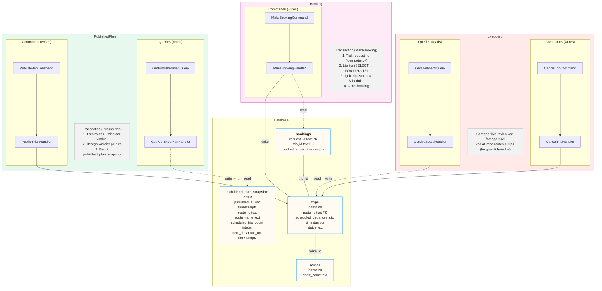
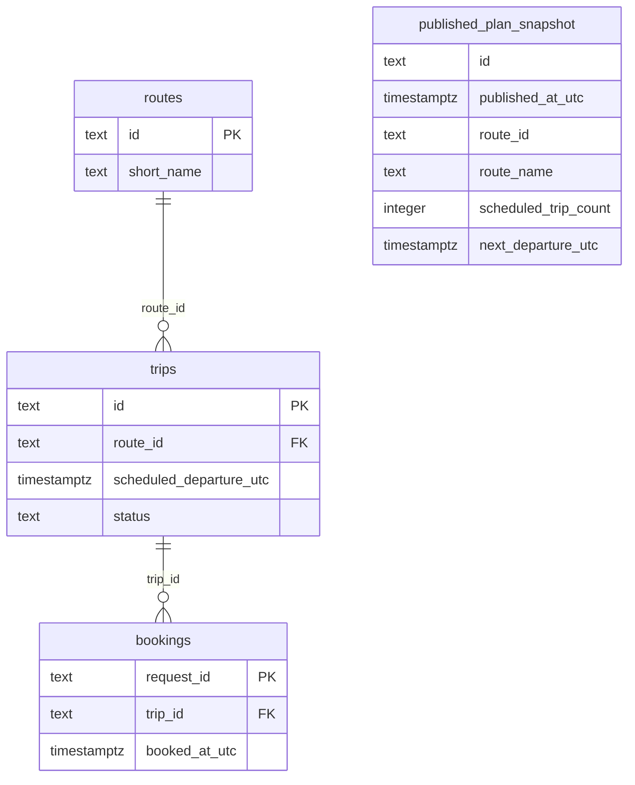

# Design A – live-tavlen beregnes, når nogen spørger

Fuld pil = write (command), stiplet pil = read (query). Tynd linje mellem tabeller = foreign key.

## Tabeller

## Fordele
- Altid korrekt og enkel.
- Ingen ekstra tabeller at holde opdateret.
- Understøtter alle tidsvinduer.

## Ulemper
- En database-forespørgsel hver gang tavlen vises.
- Kan være langsommere ved høj belastning.
