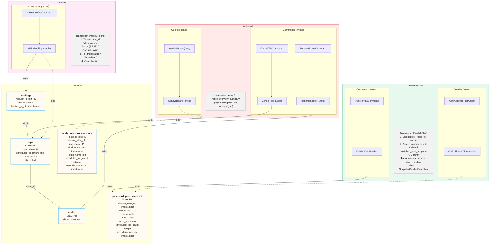
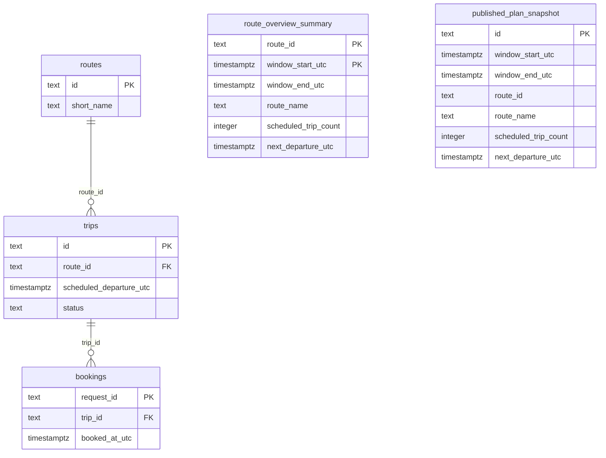

# Design B – live-tavlen læses fra en summary-tabel

Fuld pil = write (command), stiplet pil = read (query). Tynd linje mellem tabeller = foreign key.

## Tabeller

## Fordele
- Meget hurtig at læse (ingen beregning ved forespørgsel).
- Mindre belastning på databasen ved mange forespørgsler.
- Velegnet hvis det samme vindue vises ofte.

## Ulemper
- Flere ting at holde opdateret (trips + summary).
- Risiko for inkonsistens, hvis en handler glemmer at opdatere summary-tabellen.
- Understøtter primært ét tidsvindue (eller kræver flere rækker pr. vindue).
- Mere kompleksitet.
